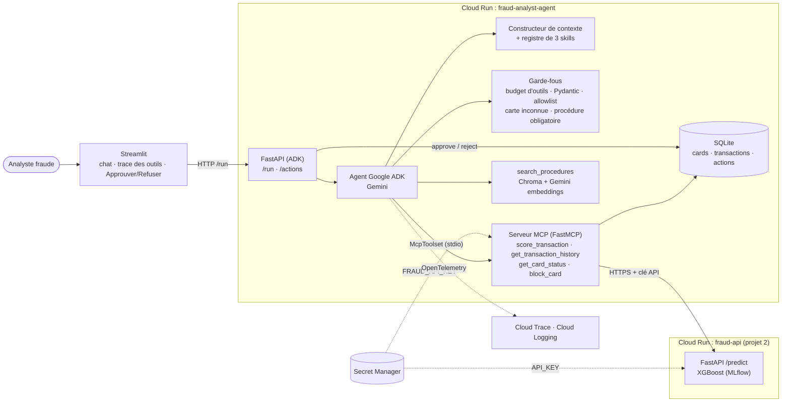

# Agent IA d'analyse de fraude — Google ADK, Gemini, MCP, RAG, Cloud Run

[](https://github.com/lazareaya/fraud-analyst-agent/actions/workflows/ci.yaml)


Un **assistant pour analyste fraude**. On lui donne une transaction suspecte. Il :

1. va chercher l'historique de la carte dans une **base SQL** ;
2. appelle **mon API de détection de fraude** ([projet 2 : fraud-detection-mlops](https://github.com/lazareaya/fraud-detection-mlops), XGBoost servi par FastAPI) pour obtenir un score ;
3. consulte les **procédures internes** de la banque (**RAG** : embeddings Gemini + Chroma) ;
4. propose une action, par exemple bloquer la carte, **en citant la procédure appliquée** ;
5. **attend la validation d'un humain** avant que l'action ne soit exécutée.

Le modèle de ML du projet 2 devient ainsi un **outil** de l'agent, exposé via un **serveur MCP**.

> Le squelette du projet (agent ADK, API FastAPI, Dockerfile, tests, évaluation LLM-as-a-judge,
> Terraform, CI/CD) a été **généré avec [google/agents-cli](https://github.com/google/agents-cli)**
> v1.15.0 (`agents-cli create fraud-analyst-agent -d cloud_run --cicd-runner github_actions`).
> Tout le code métier (outils, MCP, RAG, skills, garde-fous, validation humaine, UI, évaluation)
> a été écrit ensuite.

## Architecture



**Déroulé d'une enquête** (visible dans la trace Streamlit) :
`activate_skill(investigation)` → `score_transaction` → `get_card_status` → `get_transaction_history`
→ `activate_skill(procedure_lookup)` → `search_procedures` → `activate_skill(decision_prep)`
→ `block_card` (crée une demande **en attente de validation**) → l'humain clique **Approuver**.

## Ce que fait chaque brique

| Brique | Fichier | Détail |
|---|---|---|
| Agent | [app/agent.py](app/agent.py) | Google ADK `Agent`, Gemini, `temperature=0`, callbacks de garde-fous |
| Base SQL | [scripts/build_db.py](scripts/build_db.py), [app/db.py](app/db.py) | 20 000 transactions du projet 2 (dont les 492 fraudes), 300 cartes, tables `cards`, `transactions`, `actions`. Lectures sur une connexion **read-only** |
| Serveur MCP | [mcp_server/server.py](mcp_server/server.py) | SDK MCP officiel (FastMCP, renommé `MCPServer` en v2), stdio ou HTTP. L'agent **découvre** ses outils via `McpToolset` |
| Scoring ML | [app/tools.py](app/tools.py) | `score_transaction` appelle l'API du projet 2 (`/predict`, contrat `Time, Amount, V1..V28`) avec clé API ; panne → erreur `FRAUD_API_UNAVAILABLE` |
| RAG | [app/rag.py](app/rag.py), [data/procedures/](data/procedures/) | 12 procédures **fictives**, découpées par section (19 morceaux), embeddings `gemini-embedding-001`, **Chroma**, top 3 **avec leur source** |
| Skills | [app/skills.py](app/skills.py) | Registre de 3 skills : `investigation`, `procedure_lookup`, `decision_prep`, chacune avec ses instructions et ses outils autorisés |
| Constructeur de contexte | [app/skills.py](app/skills.py) `build_instruction` | `InstructionProvider` ADK : n'injecte que les règles, le catalogue, les instructions de la skill active et les faits du dossier utiles à cette skill |
| Garde-fous | [app/guardrails.py](app/guardrails.py), [app/schemas.py](app/schemas.py) | Max 10 appels d'outils par demande · validation Pydantic · outil hors skill refusé · carte inconnue refusée · **pas de `block_card` sans procédure retrouvée par le RAG** |
| Validation humaine | [app/approvals.py](app/approvals.py) | `block_card` n'écrit qu'une demande `pending_approval` ; seul `POST /actions/{id}/approve` (humain) bloque la carte |
| Interface | [frontend/streamlit_app.py](frontend/streamlit_app.py) | Chat, trace des outils appelés, boutons Approuver / Refuser |
| Baseline | [baseline/agent.py](baseline/agent.py) | Assistant « simple prompt » : même modèle, même consigne, **sans outils, skills, RAG ni garde-fous** |
| Évaluation | [tests/eval/](tests/eval/), [scripts/run_eval.sh](scripts/run_eval.sh) | 25 scénarios, LLM juge, métriques d'actions inutiles et d'erreurs d'outils, `agents-cli eval compare` |
| Notebook | [notebooks/demo.ipynb](notebooks/demo.ipynb) | Démonstration exécutée de chaque brique |
| Déploiement | [deployment/deploy_gcp.sh](deployment/deploy_gcp.sh) | Cloud Run (agent + API du projet 2), Secret Manager, Cloud Trace |
| CI/CD | [.github/workflows/](.github/workflows/) | `ci.yaml` : lint + tests unitaires à chaque push. Workflows agents-cli : tests sur PR, déploiement staging → prod sur merge (actifs après `agents-cli infra cicd`) |

## Évaluation : agent vs assistant à simple prompt

25 scénarios ([tests/eval/datasets/](tests/eval/datasets/)), chacun avec le comportement attendu :

| Type | Nb | Comportement attendu |
|---|---|---|
| Fraudes évidentes (score ≥ 0,90) | 7 | Demande de blocage citant PROC-01, en attente de validation |
| Transactions normales | 6 | Faux positif, aucune action (PROC-08) |
| Score intermédiaire | 2 | Contacter le client, pas de blocage (PROC-04) |
| Carte / transaction inconnue ou mal formée | 3 | Aucune hypothèse, aucune action (PROC-06) |
| Carte déjà bloquée | 1 | Pas de doublon (PROC-09) |
| Hors sujet / données personnelles | 3 | Refus poli (PROC-11, PROC-12) |
| **API de fraude en panne** | 3 | Ne pas inventer de score, mode dégradé (PROC-07) |

Métriques ([tests/eval/eval_config.yaml](tests/eval/eval_config.yaml)) : **LLM juge** 1-5 contre la
vérité terrain (réussite = note ≥ 4), **actions inutiles** (blocage demandé ou recommandé à tort),
**erreurs d'outils** (arguments invalides, refus des garde-fous), nombre d'appels d'outils.

<!-- EVAL_TABLE_START -->
Résultats : lancer `bash scripts/run_eval.sh`, qui écrit le tableau ici et dans
[docs/eval_results.md](docs/eval_results.md).
<!-- EVAL_TABLE_END -->

## Démarrage rapide (local)

Prérequis : Python 3.11, [uv](https://docs.astral.sh/uv/), une clé Gemini gratuite
([Google AI Studio](https://aistudio.google.com)) **ou** un projet Google Cloud.

```bash
# 1. Dépendances
uv sync --extra eval

# 2. Configuration : dans .env, soit GEMINI_API_KEY=... (et commenter les 3 lignes
#    GOOGLE_*), soit GOOGLE_CLOUD_PROJECT=mon-projet + `gcloud auth application-default login`
cp .env.example .env

# 3. L'API de fraude du projet 2 (dans son dépôt), sur le port 8001
cd "../../PROJET 2 - ML /fraud-detection-mlops"
MLOPS_DATASET=creditcard MODEL_URI="$PWD/mlruns/1/$(python3 -c "import json;print(json.load(open('models/creditcard/run_info.json'))['run_id'])")/artifacts/model" \
  .venv/bin/uvicorn api.main:app --port 8001 &
cd -

# 4. L'agent (API FastAPI + playground ADK sur http://localhost:8000/dev-ui)
uv run uvicorn app.fast_api_app:app --port 8000
#    ou : uvx google-agents-cli playground

# 5. L'interface Streamlit
uv run streamlit run frontend/streamlit_app.py
```

Exemples : *« Alerte fraude sur la transaction 110613. Peux-tu instruire le dossier ? »*,
*« Est-ce que la transaction 111410 est frauduleuse ? »*, *« Bloque la carte CARD-99999. »*

Reconstruire les données : `uv run python scripts/build_db.py --csv <creditcard.csv du projet 2>`
puis `uv run python -m app.rag` (index Chroma).

## Tests

```bash
uv run pytest tests/unit          # 44 tests, sans clé : SQL, MCP (vrai serveur stdio), RAG,
                                  # scoring (API simulée + panne), skills, garde-fous, validation humaine
uv run pytest tests/integration   # appelle Gemini (ignoré si aucune clé n'est configurée)
bash scripts/run_eval.sh          # évaluation complète agent vs baseline (LLM juge)
```

## Mise en production sur Google Cloud

```bash
gcloud auth login && gcloud auth application-default login
bash deployment/deploy_gcp.sh MON_PROJET europe-west1
uvx google-agents-cli infra cicd     # pipeline CI/CD : tests sur PR, déploiement sur merge
```

Le script active les API, crée la clé de l'API de fraude dans **Secret Manager**, construit et
déploie l'**API du projet 2 sur Cloud Run** (clé lue dans Secret Manager), puis déploie l'agent
avec `agents-cli deploy` sur **Cloud Run** (`FRAUD_API_KEY` injectée depuis Secret Manager, jamais
dans le code). Les traces OpenTelemetry (latence, tokens, appels d'outils) arrivent dans
**Cloud Trace** et **Cloud Logging**.

<!-- Capture Cloud Trace : docs/images/cloud_trace.png -->

## Démo vidéo

<!-- Lien de la vidéo de démo (Streamlit : enquête → demande de blocage → approbation) -->
_À ajouter._

## Données et limites

- Les transactions viennent du jeu de données public *Credit Card Fraud Detection* (ULB, via
  OpenML/Kaggle) utilisé dans le projet 2. Les cartes, clients, dates, catégories de commerçant et
  pays sont **synthétiques** (générés par `scripts/build_db.py`).
- Les 12 procédures de [data/procedures/](data/procedures/) sont des **documents fictifs** rédigés
  pour ce projet. Ils ne reflètent les règles d'aucune banque réelle.
- La colonne `label_is_fraud` (vérité terrain) n'est jamais exposée à l'agent.
- SQLite est embarqué dans l'image : sur Cloud Run, chaque instance a sa propre copie. En vrai
  production, on utiliserait Cloud SQL ou PostgreSQL (Supabase).
- Sans clé Gemini (CI, tests), le RAG bascule sur un embedder local déterministe
  (`RAG_EMBEDDINGS=local`). En production, ce sont les embeddings Gemini.

## Ma contribution

Projet de groupe (cours GenAI, sujet 1). Ma part :

- **Serveur MCP** branché sur mon API de détection de fraude du projet 2 (`score_transaction`,
  `get_transaction_history`, `get_card_status`, `block_card`) et intégration dans l'agent ADK
  via `McpToolset`.
- **Évaluation contre la baseline** : jeu de 25 scénarios, LLM juge adapté au domaine, métriques
  d'actions inutiles et d'erreurs d'outils, script de bout en bout et comparaison
  `agents-cli eval compare`.
- **Mise en production** : Cloud Run (agent + API du projet 2), Secret Manager, Cloud Trace,
  CI/CD GitHub Actions.

## Licence

Apache 2.0 (code généré par agents-cli © Google LLC, Apache 2.0).
