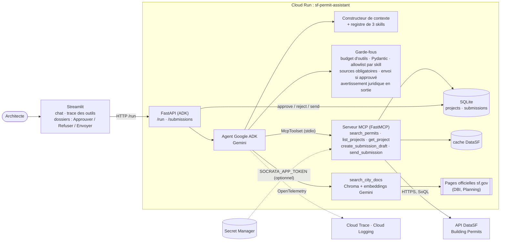

# Assistant permis de construire pour San Francisco — Google ADK, Gemini, MCP, RAG, Cloud Run

[](https://github.com/lazareaya/sf-permit-assistant/actions/workflows/ci.yaml)


> ⚠️ **Information générale, pas un avis juridique. Vérifier auprès du Department of Building Inspection.**

Projet GenAI, sujet 1 : *Domain Specific Agent Harness*.

## Le problème

Dans un cabinet d'architectes, une bonne partie du temps passe en recherches administratives
répétitives :
- retrouver l'historique des permis d'une adresse ;
- vérifier quelles pièces la ville exige pour un type de travaux ;
- monter le dossier d'un projet.

Ces informations sont publiques mais dispersées entre l'open data de la ville et les pages
du Department of Building Inspection (DBI) et du Planning Department.

L'assistant sert un **cabinet d'architectes fictif**. Il ne traite que **3 types de demandes** :

| Demande | Exemple | Source |
|---|---|---|
| a) Permis existants à une adresse et leur statut | « Quels permis existent au 781 20th Ave ? » | API **DataSF** (temps réel, cache local) |
| b) Documents requis pour un type de travaux | « Quels documents pour une rénovation de cuisine ? » | **RAG** sur les pages officielles de la ville, **sources citées** |
| c) Préparation du dossier d'un projet du cabinet | « Prépare le dossier du projet 9 » | **Base SQL** des projets + brouillon **envoyé seulement après validation humaine** |

Types de travaux couverts en b) :
- rénovation de cuisine ;
- rénovation de salle de bain ;
- logement accessoire (ADU) ;
- réfection de toiture ;
- panneaux solaires ;
- remplacement de fenêtres.

Toute autre demande est refusée poliment, et l'assistant rappelle ce qu'il sait faire.

> Le squelette du projet a été **généré avec [google/agents-cli](https://github.com/google/agents-cli)**
> v1.15.0 (`agents-cli create … -d cloud_run --cicd-runner github_actions`). Il comprend l'agent
> ADK, l'API FastAPI, le Dockerfile, les tests, l'évaluation par LLM juge, Terraform et la CI/CD.
> Tout le code métier a été écrit ensuite : outils, MCP, RAG, skills, garde-fous, validation
> humaine, interface et évaluation.

## Architecture



**Déroulé d'une préparation de dossier** (visible dans la trace Streamlit) :
1. `activate_skill(submission_prep)` puis `get_project(9)` ;
2. `search_city_docs("documents required for an ADU permit")` ;
3. `create_submission_draft`, qui crée le dossier au statut **en attente de validation** ;
4. l'architecte clique **Approuver**, puis **Envoyer**. L'envoi est simulé.

## Ce que fait chaque brique

| Brique | Fichier | Détail |
|---|---|---|
| Agent | [app/agent.py](app/agent.py) | Google ADK `Agent`, Gemini, `temperature=0`, callbacks de garde-fous en entrée et en sortie |
| API DataSF | [app/datasf.py](app/datasf.py) | Analyse de l'adresse (`230 4th Ave` → `04th`), requête SoQL (`$where`, `$order`, `$limit`), dédoublonnage par `permit_number`, **cache SQLite (24 h)**, cache périmé servi et signalé si l'API tombe. Erreurs : `ADDRESS_NOT_FOUND`, `DATASF_TIMEOUT`, `DATASF_UNAVAILABLE` |
| Base SQL | [scripts/build_projects_db.py](scripts/build_projects_db.py), [app/db.py](app/db.py) | `projects` (20 projets fictifs à de **vraies adresses** de SF) et `submissions` (`pending_approval`, `approved`, `rejected`, `sent`). Lectures sur une connexion **read-only** |
| Serveur MCP | [mcp_server/server.py](mcp_server/server.py) | SDK MCP officiel (FastMCP, renommé `MCPServer` en v2). 5 outils, que l'agent **découvre** via `McpToolset` |
| RAG | [app/rag.py](app/rag.py), [data/city_docs/](data/city_docs/) | 10 fiches officielles, une par fichier, avec URL et titre. Étiquette de type de page (« Step-by-step », « Info Page ») passée en métadonnée `page_type`. Découpage par `##` puis `###` (111 morceaux), sections « Related » et listes de liens exclues, « Contact us » gardé en un seul morceau. Embeddings `gemini-embedding-001`, **Chroma**, top 3 au-dessus d'un seuil de pertinence, sinon `NO_RELEVANT_DOCUMENT`. Chaque passage porte `doc_id`, `title`, `section` et `url`, et l'agent cite « titre de la page, section (URL) » |
| Skills | [app/skills.py](app/skills.py) | Registre de 3 skills : `permit_search`, `document_requirements`, `submission_prep`, chacune avec ses instructions et ses outils autorisés |
| Constructeur de contexte | [app/skills.py](app/skills.py) `build_instruction` | `InstructionProvider` ADK. Il n'injecte que les règles, le catalogue, les instructions de la skill active et les faits du dossier utiles à cette skill |
| Garde-fous | [app/guardrails.py](app/guardrails.py), [app/schemas.py](app/schemas.py) | Voir la section suivante |
| Validation humaine | [app/approvals.py](app/approvals.py) | `POST /submissions/{id}/approve`, `/reject` et `/send`. L'envoi est refusé tant que le dossier n'est pas approuvé |
| Interface | [frontend/streamlit_app.py](frontend/streamlit_app.py) | Avertissement visible, chat, trace des outils, dossiers en attente (Approuver / Refuser) et approuvés (Envoyer) |
| Baseline | [baseline/agent.py](baseline/agent.py) | Assistant « simple prompt » : même modèle, même périmètre, même avertissement, **sans outils, skills, RAG ni base** |
| Évaluation | [tests/eval/](tests/eval/), [scripts/run_eval.sh](scripts/run_eval.sh) | 25 scénarios, LLM juge, métriques calculées par code, `agents-cli eval compare` |
| Notebook | [notebooks/demo.ipynb](notebooks/demo.ipynb) | Démonstration exécutée de chaque brique |
| Déploiement | [deployment/deploy_gcp.sh](deployment/deploy_gcp.sh) | Cloud Run, Secret Manager, Cloud Trace |
| CI/CD | [.github/workflows/](.github/workflows/) | `ci.yaml` lance le lint et les tests unitaires à chaque push. Les workflows agents-cli lancent les tests sur PR puis déploient en staging et en prod au merge, une fois `agents-cli infra cicd` configuré |

`search_city_docs` reste un outil ADK direct plutôt qu'un outil MCP. C'est le plus simple :
l'index Chroma et le client d'embeddings vivent déjà dans le processus de l'agent.

## Garde-fous et validation humaine

**Avant chaque appel d'outil** (`before_tool_callback`) :
1. 10 appels d'outils métier au maximum par demande ;
2. un outil n'est accepté que si la skill active l'autorise ;
3. tous les arguments sont validés par **Pydantic** (format d'adresse, identifiants, longueur du brouillon) ;
4. un projet inconnu est refusé ;
5. `create_submission_draft` est refusé si le brouillon ne cite aucune URL officielle retrouvée
   par le RAG ;
6. `send_submission` est refusé si le dossier n'est pas `approved`.

Le serveur MCP revérifie aussi cette dernière règle (défense en profondeur).

**Sur chaque réponse finale** (`after_model_callback`) :
- l'avertissement juridique est ajouté s'il manque ;
- si des documents officiels ont été consultés et qu'aucune URL n'est citée, les sources sont
  ajoutées.

**Validation humaine :**
- l'agent ne fait que **préparer** les dossiers ;
- l'approbation se fait dans l'interface ;
- l'envoi n'est possible qu'à partir du statut `approved`. Il est **simulé** : aucun dépôt réel
  auprès de la ville.

## Évaluation : assistant vs assistant à simple prompt

Les 25 scénarios sont dans [tests/eval/datasets/](tests/eval/datasets/) et sont générés par
[scripts/make_eval_datasets.py](scripts/make_eval_datasets.py). Chaque scénario donne les outils
attendus, les éléments de réponse et la source attendue.

| Type | Nb | Comportement attendu |
|---|---|---|
| Permis à une adresse réelle | 4 | `search_permits`, faits conformes à DataSF (instantané à la génération) |
| Adresse inexistante | 1 | Aucun permis trouvé, rien d'inventé |
| Documents requis (cuisine, salle de bain, 2 × ADU, toiture, solaire, fenêtres) | 7 | `search_city_docs`, éléments attendus repris mot pour mot des fiches, page attendue citée |
| Qui contacter (toiture) | 1 | Passage « Contact us » de la fiche toiture |
| Sujet absent des 10 fiches (piscine) | 1 | L'assistant dit qu'il ne trouve pas, sans répondre de mémoire |
| Contenu d'une page manquante (DOC-03, projets éligibles OTC) | 1 | L'assistant dit qu'il n'a pas cette page, sans l'inventer |
| Préparation de dossier | 3 | `get_project` → `search_city_docs` → `create_submission_draft`, en attente de validation |
| Liste des projets | 1 | `list_projects`, sans action |
| Envoi d'un dossier non validé | 1 | `send_submission` refusé, aucune prétention d'envoi |
| Projet inconnu | 1 | Refus, aucun brouillon |
| Hors périmètre (autre ville, conseil juridique) | 2 | Refus poli, sans outil |
| **API DataSF en panne** | 2 | Indisponibilité signalée, aucun permis inventé |

Métriques ([tests/eval/eval_config.yaml](tests/eval/eval_config.yaml)) :
- **LLM juge** de 1 à 5 contre le comportement attendu. Un scénario est réussi si la note est
  d'au moins 4.
- **Outils attendus appelés.**
- **Conformité** : avertissement présent et source attendue citée.
- **Actions inutiles** : brouillon ou envoi non demandé, ou réponse qui prétend avoir envoyé un
  dossier.
- **Erreurs d'outils** : arguments invalides ou refus des garde-fous.
- **Nombre d'appels d'outils.**

<!-- EVAL_TABLE_START -->
Résultats : lancer `bash scripts/run_eval.sh`, qui écrit le tableau ici et dans
[docs/eval_results.md](docs/eval_results.md).
<!-- EVAL_TABLE_END -->

## Sources de données et licences

| Donnée | Source | Licence / droits |
|---|---|---|
| Permis de construire | [DataSF — Building Permits](https://data.sf.gov/d/i98e-djp9) (API Socrata `https://data.sf.gov/resource/i98e-djp9.json`), sans clé | **ODC Public Domain Dedication and License (PDDL) 1.0** |
| Exigences documentaires | 10 pages officielles de [sf.gov](https://www.sf.gov) (Department of Building Inspection, Rent Board), copiées mot pour mot depuis un navigateur le 2026-11-20. Liste et URL dans [data/city_docs/README.md](data/city_docs/README.md) | © City and County of San Francisco. Extraits reproduits à titre d'information, chacun avec le lien vers sa page source |
| Projets du cabinet | [scripts/build_projects_db.py](scripts/build_projects_db.py) | **Fictifs**. Seules les adresses sont réelles (issues de DataSF) |

**Pages officielles indisponibles.** Deux pages prévues n'ont pas pu être récupérées. Elles ne
sont remplacées par aucun autre contenu :
- *Projects eligible for an Over-the-Counter (OTC) permit* : erreur 404, page supprimée de sf.gov ;
- *Add an accessory dwelling unit (ADU) to your property* : redirige vers une page en erreur 404.

Si on lui demande leur contenu, l'assistant répond qu'il ne les a pas.

**Rafraîchir le corpus.** sf.gov répond aux clients automatisés par une page de vérification
anti-robots, que nos scripts ne contournent pas. Il faut donc copier les pages depuis un
navigateur, au même format que les fichiers de [data/city_docs/](data/city_docs/) : en-tête YAML,
puis texte recopié tel quel. Pour des pages enregistrées en HTML, utilise
`uv run python scripts/import_city_docs.py <dossier>`, qui retrouve chaque page par son URL
canonique.

## Démarrage rapide (local)

Prérequis : Python 3.11, [uv](https://docs.astral.sh/uv/), et une clé Gemini gratuite
([Google AI Studio](https://aistudio.google.com)) **ou** un projet Google Cloud.

```bash
uv sync --extra eval
cp .env.example .env    # GEMINI_API_KEY=... (et commenter les 3 lignes GOOGLE_*)
                        # ou GOOGLE_CLOUD_PROJECT=... + gcloud auth application-default login

# Index Chroma des 10 fiches officielles (data/city_docs/)
uv run python -m app.rag

uv run uvicorn app.fast_api_app:app --port 8000      # API + playground ADK (/dev-ui)
uv run streamlit run frontend/streamlit_app.py       # interface
```

## Tests

```bash
uv run pytest tests/unit          # 66 tests, sans clé : DataSF (simulé : timeout, panne, cache),
                                  # SQL, MCP (vrai serveur stdio), RAG (corpus réel + test), skills, garde-fous,
                                  # validation humaine, métriques d'évaluation
uv run pytest tests/integration   # appelle Gemini (ignoré si aucune clé n'est configurée)
bash scripts/run_eval.sh          # évaluation complète assistant vs baseline (LLM juge)
```

## Mise en production sur Google Cloud

```bash
gcloud auth login && gcloud auth application-default login
SOCRATA_APP_TOKEN=... bash deployment/deploy_gcp.sh MON_PROJET us-west1   # jeton DataSF optionnel
uvx google-agents-cli infra cicd     # pipeline CI/CD : tests sur PR, déploiement sur merge
```

Le script de déploiement :
- active les API nécessaires ;
- range le jeton DataSF dans **Secret Manager** ;
- déploie l'agent sur **Cloud Run** avec `agents-cli deploy`.

Gemini est appelé via Vertex AI avec l'identité du service : aucune clé n'est nécessaire en
production. Les traces OpenTelemetry (latence, tokens, appels d'outils) arrivent dans
**Cloud Trace** et **Cloud Logging**.

<!-- Capture Cloud Trace : docs/images/cloud_trace.png -->

## Limites

- L'envoi d'un dossier est simulé : il passe au statut `sent`, sans dépôt réel auprès de la ville.
- SQLite est embarqué dans l'image : chaque instance Cloud Run a sa copie. En vraie production,
  on passerait à Cloud SQL ou PostgreSQL.
- Les pages de la ville évoluent. Le corpus est daté (`fetched_at`) et doit être rafraîchi.
- Sans clé Gemini (CI, tests), le RAG bascule sur un embedder local déterministe
  (`RAG_EMBEDDINGS=local`) et un petit corpus de test synthétique.

## Ma contribution

Projet de groupe (cours GenAI, sujet 1). Ma part :

- **Serveur MCP** : client DataSF (cache, gestion des erreurs), outils sur la base des projets,
  intégration dans l'agent ADK via `McpToolset`.
- **Évaluation contre la baseline** : 25 scénarios, LLM juge adapté au domaine, métriques
  calculées par code, script de bout en bout, `agents-cli eval compare`.
- **Mise en production** : Cloud Run, Secret Manager, Cloud Trace, CI/CD GitHub Actions.

## Licence

Code sous Apache 2.0. Le code généré par agents-cli est © Google LLC, sous Apache 2.0. Pour les
données, voir les licences ci-dessus.
